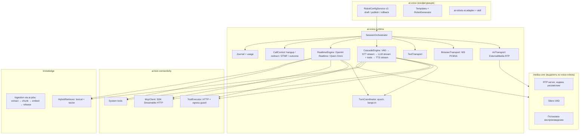

# AI Robot Studio — план рефакторинга v1.0

Дата: 2026-10-17. Режим: `codex-direct`. Аудит и находки F1–F21: [REPORT.md](REPORT.md). Координация: [EXECUTION.md](EXECUTION.md).
Предшественник: [AI-VOICE-PARITY-PLAN](../ai-products/AI-VOICE-PARITY-PLAN.md) (P1 частично, P2–P6 не выполнены). Этот план предлагается как его замена для области AI-роботов — см. OD1.

## 0. Цель и критерии успеха

**North star:** администратор АТС без опыта в AI за 10 минут создаёт робота, слышит его в браузере, ставит шагом в маршрут и видит, как прошли разговоры. Опытный пользователь получает полный контроль: промпт, модели, тулсы, MCP, знания, переменные, исходы.

| Метрика | Цель |
|---|---|
| Время от «Новый робот» до первого тестового разговора | ≤ 3 мин (шаблон), ≤ 5 мин (описание словами) |
| Обязательных решений при создании | ≤ 4: назначение, голос/пресет, провайдер (если не выбран по умолчанию), имя |
| Шаг маршрута с неготовым роботом | никогда не пропускается молча: предупреждение в редакторе + исход `error` в dialplan |
| Задержка первого звука ответа (p50) | cascade ≤ 1.2 c, realtime ≤ 0.8 c на тестовом стенде |
| Тишина в эфире при сбое модели/тула | 0: фраза-заполнитель или fallback-исход за ≤ 3 c |
| aiChat | создаёт и меняет робота, привязывает тулсы/знания и ставит в маршрут через карточки подтверждения |

## 1. Целевой продукт (UX / UI)

### 1.1 Информационная архитектура

Один модуль хаба «AI-роботы», навигация по эталону sketch findings (in-module **A+C hybrid**: боковое меню + хлебные крошки; mobile — нижняя панель):

| Раздел | Путь | Что внутри |
|---|---|---|
| Роботы | `/ai-robots/robots` | Список + студия робота `/ai-robots/robots/:uid` |
| Разговоры | `/ai-robots/conversations` | Журнал, карточка разговора, аналитика |
| Инструменты | `/ai-robots/tools` | Библиотека HTTP-тулсов и MCP-серверов тенанта |
| Знания | `/ai-robots/knowledge` | Базы знаний: документы, URL, FAQ |
| Подключения | `/ai-robots/connections` | Провайдеры моделей (существующая страница) |

Убираются как отдельные страницы: `studio`, `preview`, `sessions` (редиректы на новые пути), `sip` (за флагом, внешний SIP не в этом плане). `/ai-agents` удаляется из проекта целиком (OD3). Лендинг `/ai-robots` для непокупавших остаётся.

### 1.2 Список роботов

Стандартная таблица проекта (`table-ui-standardization`): имя + аватар голоса; **статус готовности** (Готов / Не настроен провайдер / Выключен / Не проходит тест-сценарии); пресет модели; «Где используется» (маршруты-ссылки через `route-references`); разговоры за 7 дней и доля успешных; переключатель «Включён» — optimistic toggle по `ARCHITECTURE.md`. По стандарту таблиц кнопок в строке нет: клик по строке открывает студию, «Копировать» (ровно одна выбранная строка) и «Удалить» — в `TableToolbar`; удаление подтверждается Dialog и запрещено при ссылках из маршрутов (с перечнем). Мобильный вид — `TableCard` с выбором. Пустое состояние = галерея шаблонов, а не пустая таблица.

### 1.3 Создание робота

Кнопка «Новый робот» → диалог из трёх путей:

1. **Из шаблона** — Секретарь-ресепшн, Запись на приём, Квалификация лида, Поддержка 1-й линии, Напоминание / сбор задолженности (связка с autodial), Опрос NPS, Приём заказа. Шаблон = промпт по блокам, приветствие, рекомендованные системные тулсы, схема извлекаемых данных и исходы.
2. **Описать словами** — «Робот стоматологии, записывает на приём, знает прайс, переводит на администратора при жалобах» → LLM генерирует черновик конфигурации (тот же контракт `AiRobotConfig`), показывается как превью, пользователь правит и сохраняет.
3. **С нуля** — минимальная форма.

После создания сразу открывается студия с активной тест-панелью.

### 1.4 Студия робота — рабочее пространство вместо модалки

Полная страница, три колонки на desktop (≥1280): разделы слева, редактор по центру, **тест-панель / Copilot** справа (переключатель). 768–1279: тест-панель выдвижной Sheet. Mobile: разделы вкладками, тест — bottom sheet.

Шапка: имя, статус, индикатор «есть несохранённые изменения», кнопки **Тест** и **Сохранить** (применяется к новым звонкам сразу, OD2), меню версий с diff и откатом. Уход со страницы с несохранёнными изменениями требует подтверждения.

| Раздел | Содержимое | Что скрыто под «Эксперт» |
|---|---|---|
| Обзор | Чек-лист готовности: провайдер, промпт, голос, тест пройден, стоит в маршруте; последние разговоры; где используется | — |
| Личность и промпт | Роль, цель, стиль общения, правила (guardrails), когда передавать человеку → собираются в системный промпт; редактор промпта с подсветкой переменных `{{caller_number}}`, `{{var.*}}`, автодополнением и счётчиком токенов; приветствие и режим «робот говорит первым / ждёт»; AI-действия: Улучшить, Сократить, Добавить правило, Перевести стиль | Сырой промпт целиком |
| Голос и модель | Пресеты «Быстро / Сбалансировано / Максимум качества» → режим (realtime/cascade) и провайдеры; галерея голосов с прослушиванием; язык; скорость речи | Явный выбор LLM/STT/TTS, модель, temperature, max tokens, форматы аудио |
| Знания | Привязка баз, режим поиска (по запросу модели / всегда перед ответом), поле «Проверить вопрос» с показом найденных фрагментов | Top-K, порог релевантности |
| Инструменты | Системные: Завершить звонок, Перевести (каталог назначений АТС: внутренний, группа, очередь, IVR, внешний номер), Отправить DTMF, Определить автоответчик, Вернуть в маршрут с исходом. Библиотечные HTTP-тулсы и MCP-серверы с выбором отдельных тулов. Для каждого: «когда использовать», фраза ожидания («Секунду, проверяю…»), подтверждение перед действием, таймаут | Политика side effects, ретраи |
| Поведение звонка | Перебивание, реакция на молчание (переспросить N раз → завершить/перевести), максимальная длительность, фраза при сбое, fallback-исход | VAD: тип (server / semantic), чувствительность, паузы, шумоподавление — селектами с пояснениями, не числами без смысла |
| Данные и исходы | Входные переменные (из маршрута/канала); схема извлекаемых данных (поле, тип, описание) → переменные канала `AI_*` и webhook; список исходов для ветвления маршрута; критерии успеха разговора | — |
| Версии и тесты | История сохранений, diff, откат; тест-сценарии (симуляции) и их результаты | — |

Ошибки валидации — человеческим языком рядом с полем и сводкой в чек-листе готовности; переход к первому полю с ошибкой сохраняется.

### 1.5 Тест-панель (Playground)

Три режима, один движок; тестируется **текущее состояние формы**, даже несохранённое (конфиг передаётся в запрос тест-сессии и не пишется в БД):

- **Текст** — мгновенно, без аудио: проверка промпта, тулсов, знаний, исходов.
- **Голос в браузере** — микрофон ↔ WebSocket (PCM16 16 кГц, AudioWorklet), авторизация существующим тикетом.
- **Позвонить мне** — АТС звонит на внутренний номер пользователя и соединяет с роботом (ARI originate). Нативная фишка АТС, которой нет у SaaS-конкурентов.

Транскрипт с бейджами: вызов инструмента (аргументы → результат), найденные фрагменты знаний, перебивание, задержки по фазам (STT / LLM первый токен / TTS первый байт). Кнопки: «Сохранить как тест-сценарий», «Почему он так ответил?» (передаёт ход в Copilot). Сайд-эффекты HTTP-тулсов в тесте — по политике (`sandbox` / подтверждение), системные действия симулируются.

### 1.6 Copilot (aiChat) в студии

Правая панель переключается на aiChat с контекстом страницы (uid робота, раздел, последняя тест-сессия). Сценарии: «сделай вежливее и короче», «добавь запись в Google Calendar через MCP», «почему робот перевёл звонок?», «сгенерируй 5 тест-сценариев с возражениями». Изменения приходят как `DiffConfirmCard` (существующий механизм предложений с revalidate/apply), а не прямой записью.

### 1.7 Интеграция в редактор маршрутов (`DialplanAppsEditor`)

Шаг «AI-робот» в `StepSheet`:

1. Выбор робота с бейджем статуса; неготовый робот подсвечен, при сохранении маршрута — предупреждение.
2. **«＋ Создать робота»** прямо в шаге — первый в редакторе паттерн создания сущности из шага: поле `kind: 'custom'` открывает компактный мастер в `FormSheetContent` (эталон `features/callcenter/ui/ContactBookForm`; вложенные оверлеи «модалка маршрута → Sheet шага» уже проверены вживую). Шаблон или описание → голос → сохранить — после сохранения робот выбран в шаге. Паттерн делается переиспользуемым для IVR, скриптовых роботов и очередей. **«Открыть в студии»** — в новой вкладке, каталог обновляется при возврате.
3. Переопределения для этого маршрута: приветствие, входные переменные (ключ → значение или переменная маршрута).
4. **Ветвление по исходам**: `completed`, `transferred`, `no_input`, `failed`, плюс пользовательские исходы робота → «дальше по цепочке» / перейти к шагу / маршрут. Генерация dialplan: `Stasis(krasterisk_ai_voice,robot:N,…)` → `GotoIf` по `${AI_ROBOT_OUTCOME}`; извлечённые данные доступны как `${AI_<FIELD>}` следующим шагам (webhook, TTS, CRM).
5. Summary шага: «AI-робот «Анна» · 3 исхода».
6. Ссылки защищены: робот, используемый в маршрутах, не удаляется; список «Где используется» в студии.

### 1.8 Разговоры

Таблица: время, робот, номер, длительность, исход, успех по критериям, стоимость. Карточка: аудио с синхронным транскриптом, вызовы тулсов, фрагменты знаний, извлечённые данные, waterfall задержек, ссылки на CDR, запись и речевую аналитику. Действия: «Сохранить как тест», «Разобрать в Copilot».

### 1.9 Библиотеки

- **Инструменты.** Типы: HTTP-запрос (метод, URL-шаблон, заголовки, тело, параметры JSON Schema, авторизация через секрет из `integration-credentials`, тест-консоль с примером ответа, маппинг ответа), **импорт из OpenAPI**, MCP-сервер (URL Streamable HTTP, авторизация, «Обнаружить инструменты», allowlist и политика подтверждения по каждому). Карточка показывает «используется в роботах».
- **Знания.** Источники: файлы (PDF, DOCX, MD, TXT), URL (одноразовый обход), FAQ-таблица вопрос/ответ, свободный текст. Статусы индексации, предпросмотр чанков, тест поиска, версия-релиз базы (робот закрепляет релиз, как версию провайдера).

## 2. Целевая архитектура бэкенда

### 2.1 Модули



Принципы:

- **Один движок на все транспорты.** Тест в браузере, «позвонить мне» и боевой звонок отличаются только транспортом — то, что прошло тест, работает в маршруте.
- **Рантайм читает только последнюю сохранённую неизменяемую версию** (в тест-панели — переданный конфиг формы). Идущий звонок закреплён за версией, с которой начался.
- **Fail-safe по умолчанию.** Любая ошибка провайдера/тула → фраза-заполнитель → повтор/fallback → выход из Stasis с `AI_ROBOT_OUTCOME=failed`. Никакой тишины и никакого «зависшего» канала.
- **Провайдеро-независимость** через существующий `cc_ai_providers` + `chat-endpoint.util` (OpenAI-совместимый chat с tools), адаптеры STT/TTS переиспользуют интерфейсы `voice-robots/interfaces/*`.
- **Транспорт-агностичный движок** позволит вынести рантайм в процесс `media-worker` (роль уже есть с AI-02 D5) без переписывания — OD4.

### 2.2 Модель данных v2 (аддитивно, MySQL + PostgreSQL)

- `cc_ai_agents` остаётся **идентичностью** робота (uid нужен маршрутам) и денормализованной проекцией (name, unique_id, enabled, mode, провайдеры) — пишет только `RobotConfigService`. Легаси-писатель `/ai-agents` удаляется вместе со страницей (OD3).
- `ai_robot_drafts`: + `config_json` (полный `AiRobotConfig` v2), `config_schema_version`, `current_version_id`. Настройки больше не делятся между колонками и `runtime_policy` (F6).
- `ai_robot_versions`: создаётся при сохранении **только если изменился digest**; ретенция — последние 50 и все, на которые ссылаются сессии (F7, OD2); `version_no` под блокировкой; replay по колонке `operation_key`, а не перебором JSON. Откат = сохранение конфига старой версии как новой.
- Уникальный индекс `(vpbx_user_uid, unique_id)` на `cc_ai_agents` после preflight-проверки дублей (F8).
- `ai_business_connections`: + `config_json` (HTTP: method, url template, headers, body, params schema, response mapping; MCP: url, transport, headers), `credential_ref`, `description`, `side_effect`. Discovery MCP-тулов → `ai_tool_revisions`.
- `ai_robot_test_cases` (новая): сценарий, ожидания, последний результат.
- `ai_voice_sessions`: + `robot_uid`, `outcome`, `extracted_json`, `metrics_json` (задержки, токены, стоимость), `recording_ref`.
- Знания: используются существующие `kb_*`; при необходимости + `kb_sources` (тип источника, URL, статус).
- Номер миграции подтверждается при создании (последняя на 2026-10-17 — `0046`), обе диалектики + manifest, один владелец записи схемы.

### 2.3 Контракт `AiRobotConfig` v2 (packages/shared)

Группировка вместо плоских 40 полей, с функцией миграции v1 → v2 и общей валидацией (zod-схема, из неё же JSON Schema для aiChat и MCP):

```ts
interface AiRobotConfigV2 {
  schemaVersion: 2;
  identity: { name: string; uniqueId: string; enabled: boolean; comment: string };
  persona: { role: string; goal: string; style: string; rules: string[]; handoffWhen: string[] };
  prompt: { instruction: string; greeting: string; speaksFirst: boolean; variables: RobotVariable[] };
  speech: { preset: 'fast' | 'balanced' | 'quality' | 'custom'; mode: 'realtime' | 'cascade';
    llm: ProviderRef; stt?: ProviderRef; tts?: ProviderRef; voice: string; language: string; speed: number;
    audio: { input: AudioFormat; output: AudioFormat } };
  behavior: { turnDetection: 'server_vad' | 'semantic_vad'; eagerness: 'low' | 'medium' | 'high' | 'auto';
    vad: { threshold: number; prefixPaddingMs: number; silenceMs: number }; interruptible: boolean;
    silence: { repromptAfterMs: number; maxReprompts: number; then: 'hangup' | 'fallback' };
    maxCallMs: number; fillerPhrases: boolean; failurePhrase: string };
  knowledge: { bases: Array<{ id: string; releaseId?: string }>; mode: 'on_demand' | 'always'; topK: number };
  tools: { system: SystemToolBinding[]; library: Array<{ toolId: string; allow?: string[];
    whenToUse: string; confirm: boolean; waitPhrase?: string; timeoutMs: number }> };
  analysis: { extract: ExtractField[]; outcomes: OutcomeDef[]; successCriteria: string[];
    webhookToolId?: string };
}
```

### 2.4 Безопасность инструментов

Egress-guard: только https (http по явному флагу тенанта на BOX), запрет приватных/loopback/metadata адресов после DNS-резолва, лимиты размера и времени, без следования редиректам на запрещённые адреса. Секреты — только ссылкой на `integration-credentials`, в снимке робота и логах их нет. Аргументы валидируются по JSON Schema; `mutate`-тулы — по политике `deny_mutate | sandbox | approved` (существующий `authorizeToolCall`). Идемпотентность через `operation_key`, аудит в `ai_voice_events`, PII-маскирование в журнале по настройке. Промпт-инъекции из ответов тулов и документов оборачиваются `wrapUntrustedData` (уже есть в ai-platform).

### 2.5 API v2 (под `/api/ai-voice`, JWT + `TenantContextGuard`)

`robots` CRUD + `versions` / `versions/:id/diff` / `rollback` / `readiness` / `references`; `robots/generate` (описание → черновик); `templates`; `playground/sessions` (text, ws-ticket, call-me); `conversations` (список, карточка, аудио); `tools` CRUD + `test` + `openapi-import`; `mcp-servers/:id/discover`; `knowledge` bases / sources / upload / status / search; `capabilities` — из реальных провайдеров (F13). Легаси `agents/:uid/publish` и ручные `deployments` снимаются (семантика OD2 их не требует); внутренние deployment-строки остаются служебной связкой «робот → текущая версия» для рантайма и autodial preflight.

### 2.6 aiChat: адаптер и скил (правило D-16)

`ai-voice` переводится в `covered`: `ai-robots-ai.adapter.ts` с тулами `list_ai_robots`, `describe_ai_robot`, `create_ai_robot`, `update_ai_robot` (proposal + diff; применение = сохранение в бой), `rollback_ai_robot`, `attach_robot_tool`, `attach_robot_knowledge`, `test_ai_robot_text` (read-only прогон текущего или предложенного конфига), `list_ai_tools`, `list_knowledge_bases`; `src/skills/ai-robots/SKILL.md` (как собрать хорошего голосового робота, типовые ошибки). Исправить каталог шага `ai_voice_robot` (`robot_uid`, исходы) в `dialplan-app-catalog.ts` (F3). Фронтенд передаёт контекст страницы студии в `useAssistantContext`.

## 3. Решения владельца

| ID | Вопрос | Рекомендация | Альтернатива |
|---|---|---|---|
| OD1 | Отношение к активному `AI-VOICE-PARITY` (владелец `/root`, P2–P6 не начаты) | Этот план заменяет AI-VOICE-PARITY для AI-роботов; его P1 становится входом S1; запись в EXECUTION ai-products — ссылка, без переписывания чужих статусов | Вести как продолжение AI-VOICE-PARITY с новыми задачами |
| OD2 | Семантика сохранения | **Черновик + «Опубликовать»** с diff и откатом; тест-панель работает на черновике. Для простоты одна главная кнопка «Сохранить и опубликовать» | Оставить «Сохранить = сразу в бой» (решение AI-VOICE-PARITY), добавить только историю и откат |
| OD3 | Легаси `/ai-agents` (`AiAgentsPage`, `AiAgentModal`, `PUT /ai-agents`) | Закрыть запись, страницу — редирект в студию; GET оставить для совместимости одну версию | Оставить только чтение навсегда |
| OD4 | Где живёт рантайм | MVP в процессе backend (как скриптовые роботы) с жёстким лимитом сессий; движок транспорт-агностичный; вынос в `media-worker` — этап S9 | Сразу отдельный процесс `media-worker` |
| OD5 | Порядок | Вертикальный срез: контракт v2 → **текстовая тест-панель** (LLM + тулсы + знания без аудио) → студия UI → голос (ARI + браузер) | Сначала полный голосовой рантайм, UI потом |
| OD6 | Приоритет провайдеров | Cascade: Yandex SpeechKit STT/TTS + любой OpenAI-совместимый LLM (включая aiPBX/Ollama); realtime: OpenAI Realtime, затем Qwen Omni | Realtime первым |
| OD7 | Векторный поиск | Портируемые векторы (существующий `embeddings`/nomic, хранение в БД) + лексический гибрид; без pgvector, так как MySQL обязателен | pgvector для PG-инсталляций |
| OD8 | Визуальный конструктор сценариев (граф узлов) | Не сейчас: prompt-first + структурированные блоки + исходы закрывают ~90 % кейсов; граф — этап «Later» | Делать граф в этом плане |
| OD9 | Тестовые вызовы | Только стенд `root@ipbx.krasterisk.ru`, одноразовые ресурсы, без production и без платных номеров; реальные провайдеры — ключи тенанта-стенда | — |
| OD10 | Внешний SIP / публичный API роботов | Вне плана, скрыть страницу SIP за флагом | Развивать параллельно |

**Принято владельцем 2026-10-17:**

- **OD1 — заменяет.** Этот план заменяет AI-VOICE-PARITY для AI-роботов; реализованный P1 (типизированный конфиг, транзакционное сохранение, снимки) — вход S1.
- **OD2 — «Сохранить = сразу в бой».** Отдельной публикации нет. Каждое сохранение создаёт версию и применяется к новым звонкам; идущие звонки закреплены за своей версией. Добавляются история версий, diff и откат (откат = сохранение старой версии как новой). Тест-панель гоняет **текущее состояние формы** без сохранения. Защита от роста: новая версия не создаётся, если digest не изменился; хранятся последние 50 версий и все, на которые ссылаются сессии.
- **OD3 — удалить.** Страница `/ai-agents`, `AiAgentModal`, `features/ai-agents`, CRUD агентов и наборов инструментов в `ai-agents.controller`, соответствующие RTK-эндпоинты, пункты навигации, хаба и локали выпиливаются. Таблица `cc_ai_agents` остаётся идентичностью робота; эндпоинты провайдеров, которые ещё живут под `/ai-agents/providers/*`, переносятся к `ai-connectivity` до удаления контроллера.
- **OD5 — вертикальный срез:** контракт v2 → текстовая тест-панель → студия → голосовой рантайм.
- OD4, OD6–OD10 не обсуждались — до пересмотра действуют рекомендации из таблицы.

## 4. Этапы и задачи

Каждая задача: владелец записи — назначенный исполнитель; общие миграции, manifest, locales, router, shared-типы — один владелец (координатор). Статусы фиксируются раздельно: implemented / automated-tests-passed / live-verified.

### S0. Стабилизация и подготовка (1–2 дня)

| ID | Задача | Находки | Приёмка |
|---|---|---|---|
| R0.1 | Сверка ownership с ai-products (OD1), свежий baseline, запись назначения в EXECUTION | — | Назначение записано, чужие dirty-изменения сохранены |
| R0.2 | Fail-closed секрет тикетов: без `AI_VOICE_TICKET_SECRET` выдача тикетов → 503 + health warning | F9 | Unit-тест, нет константы в коде |
| R0.3 | Шаг маршрута с неготовым/неподписанным роботом: предупреждение в `DialplanAppsEditor` и `NoOp`+переменная исхода `failed` в dialplan до появления рантайма | F1 | Тест генерации dialplan, тест UI-предупреждения |
| R0.4 | Контракт шага `ai_voice_robot`: каталог aiChat (`robot_uid`, честное описание), `defaultParams` в `registry.ts:299` → `robot_uid`, в каталоге шага неготовые роботы видны с пометкой, а не скрыты | F3 | Тесты каталога и registry |
| R0.5 | Мелкие дефекты: `created_by` в knowledge, URL-фильтр документов, `channel_kind:'sip'`, вкладка наборов на легаси-странице | F11, F5, F20 | Unit-тесты |
| R0.6 | Удалить мёртвый `RobotStudioPanel.tsx` и тестовые дубли `voice-engine` in-memory (оставить чистые функции тикетов) | F2, F5 | Сборка/тесты зелёные |

### S1. Контракт v2 и единый источник истины (3–5 дней)

| ID | Задача | Приёмка |
|---|---|---|
| R1.1 | `AiRobotConfigV2` + zod-схема + миграция v1→v2 + генерация JSON Schema в `packages/shared` | Roundtrip v1→v2 без потерь на фикстурах всех текущих полей |
| R1.2 | Миграция БД (обе диалектики): `config_json`, `current_version_id`, `operation_key`, уникальный индекс после preflight дублей, поля сессий | Dual-DB contracts на стенде, replay no-op |
| R1.3 | `RobotConfigService` v2: save с ревизией (= сразу в бой, OD2), версия только при смене digest, ретенция, история/diff/rollback, readiness, references; проекция в `cc_ai_agents` | Транзакционные тесты + реальный MySQL/PG rollback/конкурентность |
| R1.4 | Удалить легаси `/ai-agents` (OD3): инвентарь потребителей (`aiAgentsApi`, inventory/readiness, autodial preflight, cloud-admin, тесты) → перенос провайдерских эндпоинтов к `ai-connectivity` → удаление `AiAgentsPage`, `features/ai-agents`, CRUD агентов/наборов в контроллере, роута, навигации, хаба, локалей; данные `cc_ai_toolsets` не удаляются миграцией без отдельного решения | `rg` не находит ссылок, все тесты зелёные, нет пути записи в `cc_ai_agents` мимо сервиса |
| R1.5 | `capabilities` из реальных провайдеров тенанта | Тест |

### S2. Текстовый движок и тест-панель (5–7 дней)

| ID | Задача | Приёмка |
|---|---|---|
| R2.1 | `ConversationEngine` (транспорт-агностичный): сборка промпта из блоков и переменных, стриминг LLM через `chat-endpoint.util`, цикл function calling, бюджет ходов/токенов | Unit + контракт с фейковым OpenAI-совместимым сервером |
| R2.2 | Системные тулы в симуляции (end_call, transfer, outcome, DTMF) + журнал `ai_voice_turns/events` | Журнал воспроизводит ход с вызовами |
| R2.3 | API playground (text) + SSE-стрим | HTTP-тесты, изоляция тенанта |
| R2.4 | Поднять пузыри и diff-карточку чата (`AssistantBubble`, `UserBubble`, `TimelineList`, `DiffConfirmCard`) из `features/ai-chat` в `widgets`/`shared`, чтобы не нарушать FSD; aiChat переключить на новые импорты | Регресс тестов ai-chat |
| R2.5 | Фронт: `TestPanel` (текст), транскрипт с бейджами тулсов/знаний/задержек на общих пузырях | Компонентные тесты, браузерная проверка |

### S3. Студия UI (7–10 дней)

| ID | Задача | Приёмка |
|---|---|---|
| R3.0 | Недостающие общие компоненты в `shared/ui`: `EmptyState`, `Stepper` (мастер), `PromptEditor` (Textarea с подсветкой и автодополнением `{{переменных}}`, счётчик токенов; без CodeMirror/Monaco, если хватит — решение на старте этапа), resizable-разделитель панелей | Компонентные тесты, обе темы |
| R3.1 | Навигация модуля и роуты (1.1), редиректы старых путей, единая локаль `aiRobots.*` | Тест роутинга, хаб-сид обновлён |
| R3.2 | Список роботов (1.2): статусы, «где используется», optimistic toggle, удаление с защитой ссылок, mobile cards | Тесты таблицы, стандарт таблиц |
| R3.3 | Мастер создания: шаблоны, «описать словами» (`robots/generate`), с нуля | E2E в браузере: шаблон → тест-панель < 3 мин |
| R3.4 | `RobotWorkspace`: layout 3 колонки / Sheet / mobile, шапка со статусом, «Сохранить», guard несохранённых изменений, версии с diff и откатом | Визуальная проверка 1440/1024/390, светлая/тёмная тема |
| R3.5 | Разделы: Обзор, Личность и промпт (блоки, переменные, AI-действия), Голос и модель (пресеты, галерея с прослушиванием), Поведение, Данные и исходы | Поле → API → снимок → движок (roundtrip-тест на каждый раздел) |
| R3.6 | Удаление `RobotSettingsForm`/`RobotEditor` (модалка) после переноса | Нет мёртвого кода |

### S4. Голосовой рантайм (10–15 дней)

| ID | Задача | Приёмка |
|---|---|---|
| R4.1 | Выделить `media-core` из `voice-robots`: `AudioService` (удалить дубль `alaw-decoder`), `RtpSession`/`RtpUdpServerService` с проверкой peer/payload type/SSRC из `ai-voice/rtp-guard.ts`, `StreamAudioService` (SSRC на звонок, параметр payload type, сигнал «проиграно мс» для обрезки при перебивании), `SileroVadProvider` (общая ONNX-сессия, сериализация кадров), `tts-pipeline-abort`, `TtsCacheService`, фабрики STT/TTS, ресемплинг с антиалиасингом для 16/24 кГц. Сессия скриптовых роботов переводится на `media-core` без изменения сценарной логики | Регресс тестов voice-robots, живой звонок скриптового робота на стенде до и после |
| R4.1a | Исправить дефекты жизненного цикла, найденные при аудите (F24–F26), в общем коде и в скриптовой сессии: проверка `cleanedUp` между шагами `start()`, hangup звонящего при сбое настройки, отслеживаемые таймеры ретрая STT, ограниченный `sttBuffer`, ожидание `streamAudio` для barge-in, лимит длительности звонка и сессий по умолчанию, batch STT через фабрику, двойной префикс `sound:`, SSRF-guard для webhook | Unit-тесты на каждый дефект + живой тест «hangup во время настройки» без утечки сокетов/мостов |
| R4.2 | Подписка ARI на `krasterisk_ai_voice`, `StasisStart` → проверка тенанта канала → загрузка текущей сохранённой версии → сессия; выход из Stasis с `AI_ROBOT_OUTCOME` и `AI_*` | Живой тест L2 |
| R4.3 | `CascadeEngine`: VAD → потоковый STT → LLM стрим → TTS по предложениям, barge-in через `TurnCoordinator`, филлеры, тишина/реприз, лимиты | Живые тесты L2–L4, задержки в журнале |
| R4.4 | `CallControl`: hangup, redirect на назначение АТС из каталога, DTMF, исходы; idempotent `operation_key` | Живой тест перевода L5 |
| R4.5 | Браузерный голос: WS-транспорт PCM16 + AudioWorklet, тикет; «Позвонить мне» через ARI originate | Браузерный тест L6 |
| R4.6 | Лимит сессий на тенант/узел, учёт usage, health | Нагрузочный L8 |

### S5. Инструменты и MCP (7–10 дней)

| ID | Задача | Приёмка |
|---|---|---|
| R5.1 | Модель HTTP-тула v2, CRUD, тест-консоль, импорт OpenAPI | HTTP-тесты, фикстура OpenAPI |
| R5.2 | `ToolExecutor` + egress-guard + секреты из `integration-credentials` + политика side effects | Тесты SSRF (приватные IP, редиректы, DNS rebinding) |
| R5.3 | `McpClient` (SDK, Streamable HTTP), discover → revisions, allowlist, подтверждение | Тест с фейковым MCP-сервером + живой L7 |
| R5.4 | UI библиотеки инструментов и раздел «Инструменты» студии | Браузерная проверка |

### S6. Базы знаний (5–8 дней)

| ID | Задача | Приёмка |
|---|---|---|
| R6.1 | Загрузка через `media-assets`, извлечение TXT/MD/PDF/DOCX, URL, FAQ; pipeline в `ai-jobs` | Тесты ingestion на фикстурах |
| R6.2 | Чанкинг по структуре (заголовки/абзацы), эмбеддинги, релизы, гибридный поиск | Recall@5 на эталонном корпусе ≥ 0.8 |
| R6.3 | Тул `search_knowledge` в движке, режим always/on-demand, цитаты в журнале | Тест движка |
| R6.4 | UI баз знаний и раздел «Знания» в студии с тестом вопроса | Браузерная проверка |

### S7. Редактор маршрутов (4–6 дней)

| ID | Задача | Приёмка |
|---|---|---|
| R7.1 | Схема шага: робот + переопределения + входные переменные + ветвление по исходам; генерация dialplan `GotoIf` по `AI_ROBOT_OUTCOME` | Тесты `dialplan.util`, живой L9 |
| R7.2 | Статус робота в picker, «Создать робота» (компактный мастер в Sheet), «Открыть в студии» с обновлением каталога | Компонентные тесты StepSheet |
| R7.3 | Защита ссылок, «Где используется», summary шага | Тест route-references |

### S8. aiChat и Copilot (4–6 дней)

| ID | Задача | Приёмка |
|---|---|---|
| R8.1 | `ai-robots-ai.adapter.ts`, скил, перевод в `covered` | `ai-adapter-completeness.spec.ts` зелёный |
| R8.2 | Тулы генерации/правки через proposals, `test_ai_robot_text` | Eval-харнесс: 10 запросов на настройку робота, ≥ 8 корректных предложений |
| R8.3 | Контекст страницы: расширить `useAssistantContext` union (`module: 'ai-robots'`, `robot_uid`, `section`, `test_session_id`, `dirty`) и добавить backend-валидатор рядом с `autodial-page-context.ts`; Copilot-панель в студии | Тест валидатора (чужой тенант отклонён), браузерная проверка |

### S9. Наблюдаемость, качество, realtime (10–14 дней)

| ID | Задача | Приёмка |
|---|---|---|
| R9.1 | Журнал разговоров и карточка (аудио + транскрипт, waterfall, данные, ссылки на CDR/запись) | Браузерная проверка на живых сессиях |
| R9.2 | Пост-анализ: извлечение данных, критерии успеха, webhook | Тест на записанных сессиях |
| R9.3 | Тест-сценарии (симуляции): LLM-«звонящий» + LLM-судья, pass rate, запуск из UI и aiChat | 5 сценариев шаблона «Запись на приём» проходят |
| R9.4 | `RealtimeEngine`: OpenAI Realtime (semantic VAD, function tools на сервере), затем Qwen Omni | Живой L4-realtime |
| R9.5 | Вынос рантайма в `media-worker` (если OD4 = MVP in-process) | Перезапуск API не рвёт звонки |

Ориентир всего плана: 12–16 недель одного фулстек-разработчика или 7–9 недель при двух параллельных потоках (бэкенд-рантайм ‖ фронтенд-студия) после S1.

## 5. Тестирование и гейты

- Каждый срез: `npm run lint`, `npm run test:backend`, `npm run test:frontend` + целевые тесты; известные чужие падения фиксируются отдельно, не чинятся вне scope.
- Схема: dual-DB contracts MySQL 8.4 / PostgreSQL 17 на стенде `root@ipbx.krasterisk.ru` в одноразовых контейнерах; локальный Docker не используется.
- Браузер: 1440 / 1024 / 390, светлая и тёмная темы, RU/EN.
- Живые тесты (стенд, тестовый тенант, без production):

| ID | Сценарий | Доказательство |
|---|---|---|
| L1 | Текстовый тест робота с тулом и знаниями | Журнал сессии с вызовами |
| L2 | Входящий на тестовый DID → маршрут → AI-робот cascade → приветствие и 3 реплики | Запись, журнал, задержки |
| L3 | Перебивание робота голосом | `output_epoch` растёт, воспроизведение остановлено ≤ 300 мс |
| L4 | Сбой провайдера LLM (неверный ключ) | Фраза о сбое, выход `failed`, маршрут продолжился |
| L5 | Перевод на очередь/внутренний из каталога | Канал в очереди, исход `transferred` |
| L6 | Голос в браузере и «Позвонить мне» | Сессии с `ingress_kind` browser/call_me |
| L7 | MCP-тул на фейковом MCP-сервере стенда | Вызов в журнале, allowlist соблюдён |
| L8 | 5 параллельных звонков, лимит 5 | 6-й получает fallback, память стабильна |
| L9 | Ветвление по исходам в маршруте и передача `AI_*` в webhook | Webhook получил данные |
| L10 | aiChat: «создай робота записи на приём и поставь в маршрут 777» | Две подтверждённые карточки, звонок проходит |

Гейты: **G1** после S1 (контракт, миграции), **G2** после S2+S3 (текстовый робот в студии), **G3** после S4 (живой голос), **G4** после S5–S7 (тулсы, знания, маршруты), **G5** после S8–S9 (aiChat, наблюдаемость, realtime). Релиз пользователям — не раньше G3.

## 6. Риски

| Риск | Митигация |
|---|---|
| Пересечение с владельцем AI-VOICE-PARITY и соседними dirty-изменениями (speech analytics, провайдеры) | OD1, сверка baseline перед каждой записью, один владелец общих файлов |
| Регресс скриптовых роботов при выделении `media-core` | R4.1 без изменения поведения, их регресс-тесты и живой звонок до/после |
| Задержки cascade на CPU (VAD, ресемплинг) в общем процессе | Лимит сессий, метрики, S9 вынос в `media-worker` |
| Стоимость провайдеров при тестах и симуляциях | Лимиты на тест-панель, счётчик стоимости в журнале, usage shadow |
| SSRF / утечка секретов через тулсы | R5.2 до включения любого живого исполнителя |
| Галлюцинации и опасные действия | Guardrails-блок промпта, подтверждение для mutate-тулов, предупреждение при сохранении, если тест-сценарии робота не проходят |

## 7. Рекомендации по новым функциям (тренды 2026)

**Now (в этом плане):** шаблоны и генерация робота из описания; тест-панель текст/голос/«позвонить мне»; системные тулсы с каталогом назначений АТС; MCP с allowlist и подтверждением; RAG с цитатами; динамические переменные; извлечение данных и исходы в dialplan; semantic VAD; филлеры при долгих тулсах; история версий с diff и откатом; симуляции с LLM-судьёй; Copilot-настройка через aiChat.

**Next:** A/B-эксперименты версий по доле трафика; определение автоответчика (AMD) и IVR для исходящих autodial; мультиязычность с автоопределением языка; handoff между роботами (специализированные агенты); передача оператору КЦ с саммари разговора в карточку (screen pop) — нативное преимущество АТС; клонирование голоса (если провайдер поддерживает) с согласием; PII-редакция в журнале и записи; бюджеты и алерты стоимости.

**Later:** визуальный граф сценария (узлы, ветвления, подсценарии) поверх тех же исходов; живой мониторинг разговоров роботов с подслушиванием и перехватом оператором (ChanSpy/Barge); омниканальность (тот же робот в веб-виджете и мессенджерах); автоматическое улучшение промпта по проваленным разговорам («self-improving» цикл с подтверждением человеком); маркетплейс шаблонов роботов между тенантами.
