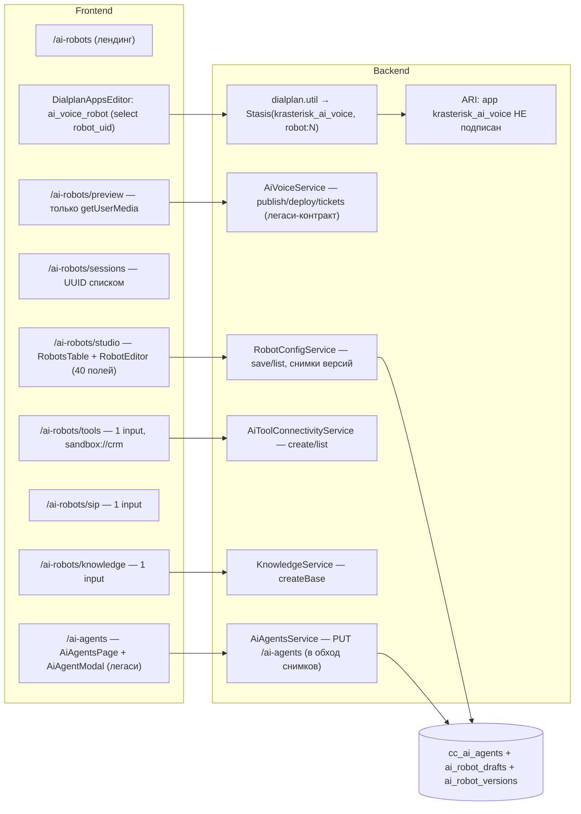

# AI Robot Studio — аудит текущей реализации (2026-10-17)

Область: `packages/frontend/src/pages/AiRobots*Page`, `features/aiRobots`, `features/ai-agents`, `shared/api/endpoints/{aiAgentsApi,aiVoiceRobotsApi}`, интеграция `ai_voice_robot` в `features/dialplan-apps`; backend `modules/ai-voice`, `ai-tool-connectivity`, `knowledge`, `ai-agents`, `ai-connectivity`, ARI, `routes/dialplan-app-catalog`, `ai-platform`; shared `types/ai-voice.types.ts`.
Метод: чтение кода, история планов (`initiatives/ai-products/AI-VOICE-PARITY-*`, `mpbx-voice-robots`), сверка с рынком (ElevenLabs Agents, Retell, Vapi, OpenAI Realtime). Тесты и живые вызовы не запускались.

## 1. Итог в одном абзаце

У AI-роботов есть хорошо спроектированное **хранилище конфигурации** (типизированный конфиг в `packages/shared`, транзакционное сохранение с ревизией, неизменяемые снимки версий, изоляция тенанта), но **нет продукта вокруг него**: робот не может принять ни одного звонка (нет рантайма и даже подписки ARI), «Тест в браузере» только включает микрофон, страницы тулсов / MCP / баз знаний — заглушки на одно поле ввода, aiChat про AI-роботов не знает, а одну и ту же таблицу `cc_ai_agents` редактируют три разных интерфейса. Оценка зрелости: **данные 6/10, бэкенд-рантайм 1/10, UX 2/10, интеграция с маршрутами 3/10, aiChat 0/10**. Рефакторинг — это не «переделать форму», а достроить вертикаль: конфиг → рантайм → тест → наблюдаемость, и уже поверх неё — удобную студию.

## 2. Карта текущего состояния

## 3. Что уже хорошо и сохраняется

| Актив | Где | Почему ценно |
|---|---|---|
| Единый типизированный конфиг и валидация на обеих сторонах | `packages/shared/src/types/ai-voice.types.ts` | Один контракт для формы, API и рантайма; лимит в байтах UTF-8 |
| Транзакционное сохранение с `If-Match`-ревизией, блокировками и снимком провайдеров без секретов | `ai-voice/robot-config.service.ts:116-168` | Правильная основа для черновиков/версий и закрепления конфига за идущим звонком |
| Модель сессии: turns с `input_turn_id`/`output_epoch`, events, call-control operations, тикеты допуска | `ai-voice.models.ts`, `turn-coordinator.ts`, `voice-engine.ts:166-203` | Готовая схема журнала и barge-in семантики — нужен только исполнитель |
| Рабочий медиаконвейер скриптовых роботов (ExternalMedia/RTP, Silero VAD, STT/TTS, barge-in) | `voice-robots/services/*` | Источник для выделения общего `media-core`, не писать с нуля |
| Контракт AI-платформы: адаптер домена, предложения с diff-карточкой, revalidate/apply | `ai-platform/ai-adapter.types.ts`, `ai-mutation.contract.ts` | Готовый механизм «настрой через aiChat с подтверждением» |
| Каталог провайдеров с capability (`llm/stt/tts/realtime`), шифрование ключей, `chat-endpoint.util` | `ai-connectivity/*` | Выбор моделей и вызов LLM без нового слоя |
| Продуктовый доступ, тенантные интеграционные ключи | `product-access`, `integration-credentials` | Лицензирование и внешний API уже есть |
| `@modelcontextprotocol/sdk` и `@dnd-kit/*` уже в зависимостях | `package.json` | MCP-клиент и сортировка шагов без новых пакетов |

## 4. Находки

Severity: **C** — ломает продукт/безопасность, **H** — серьёзный дефект или блокер цели, **M** — долг/UX, **L** — косметика.

### Рантайм и интеграция с АТС

- **F1 (C). Робот не принимает звонки.** `dialplan.util.ts:417-426` генерирует `Stasis(krasterisk_ai_voice, robot:N)`, но приложение не входит в список подписки ARI (`ari-http-client.service.ts:336-339`, `getEventAppNames` возвращает только скриптовое и autodial-приложения), обработчика `StasisStart` для владельца `ai_voice` нет; `classifyAriEvent`/`assertChannelOwner` используются только в тесте. То же касается `autodial-dialplan.util.ts:213`. Asterisk сразу возвращает ошибку Stasis, и маршрут **молча идёт дальше** — администратор видит шаг «AI-робот» в маршруте, а звонящий его никогда не слышит. Это подтверждено и в `AI-VOICE-PARITY-HANDOFF.md` («Current `robot:uid` argument has no runtime consumer»).
- **F2 (C). «Рантайм» состоит из чистых функций и фейков.** `realtime-session.ts` — только `createFakeVoiceModelSession`; `turn-coordinator.ts` и `call-control.ts` нигде не вызываются вне тестов; `voice-engine.ts:37-249` дублирует логику `AiVoiceService` на in-memory `Map` для unit-тестов. LLM-клиента с function calling для роботов нет, адаптеров realtime-вендоров нет.
- **F3 (H). Расхождение контракта шага маршрута.** UI и `dialplan.util` используют `robot_uid`, а каталог для aiChat `routes/dialplan-app-catalog.ts:101-106` требует `deployment_id` и описывает шаг как «опубликованное cascade-развёртывание». aiChat будет собирать неверные шаги.
  Внутри самого фронтенда то же расхождение: `registry.ts:299` задаёт `defaultParams: { deployment_id: '' }`, а схема шага пишет `robot_uid` (`schemas/aiVoiceRobot.tsx:9`). Каталог шага показывает только роботов с `versionId`, без объяснения, почему остальных нет.
- **F4 (H). Нет выходов из робота.** Шаг — тупик: робот не возвращает в маршрут результат (переведён / завершил / не понял / ошибка), не передаёт извлечённые данные в переменные канала. Перевод (`allowTransfer`) — свободный текст номеров вместо каталога назначений АТС.

### Модель данных и бэкенд

- **F5 (H). Три редактора одной таблицы.** `cc_ai_agents` пишут: новый `RobotEditor` (через `/ai-voice/robots`, со снимками), легаси `AiAgentsPage` + `AiAgentModal` (`PUT /ai-agents/:id` — **в обход** версий и deployments; переключатель enabled на странице не меняет статус развёртывания), и мёртвый `RobotStudioPanel.tsx` (нигде не импортируется). В `AiAgentModal` есть `channel_kind: 'sip'`, которого нет в ENUM модели.
- **F6 (H). Два источника истины для настроек.** Часть полей живёт в колонках `cc_ai_agents`, остальное — в `ai_robot_drafts.runtime_policy.settings` (JSON в TEXT). `robotConfigFromRows` (`robot-config.service.ts:27-42`) склеивает их с неочевидным приоритетом (VAD из колонок → перекрывается settings → перекрывается колонками).
- **F7 (M). Версия на каждое сохранение.** Каждое `save` создаёт `ai_robot_versions` (до 60 КБ) и переключает deployments в `ready` — неограниченный рост, нет понятия «черновик / опубликовано / откат». Легаси `publish` нумерует версии через `previous.length + 1` и ищет replay перебором с `JSON.parse` всех версий (`ai-voice.service.ts:83-86`).
- **F8 (H). Уникальность `unique_id` не гарантирована БД** — только предварительная проверка в транзакции (зафиксировано в HANDOFF как открытый пункт).
- **F9 (C). Секрет тикетов по умолчанию.** `ai-voice.service.ts:41-43`: при отсутствии `AI_VOICE_TICKET_SECRET` используется константа `'ai-voice-ticket-dev'` — подделываемые тикеты допуска в любом окружении, где переменную забыли. Нужен fail-closed.
- **F10 (H). Тулсы — каркас.** `ai_business_connections` хранит `name/kind/destination` (строка до 256), нет схемы параметров, авторизации, тела запроса, теста; `publishTool`/`bind` не вызываются из API. Исполнителя HTTP/MCP нет, `probe()` возвращает `liveMcp:false`. Когда исполнитель появится, свободный `destination` = SSRF без egress-политики.
- **F11 (H). Базы знаний — каркас.** Из 8 таблиц `kb_*` API использует одну (`createBase`); загрузки, извлечения текста, чанкинга, эмбеддингов, релизов и поиска через API нет. `knowledge-engine.ts:11` отвергает любой документ, где встречается `https://` (ложные срабатывания на обычных FAQ). `knowledge.service.ts:37`: `Number('user:12')` → `NaN` → `created_by = 0`.
- **F12 (H). aiChat не умеет AI-роботов.** `ai-platform/module-coverage.registry.ts:71-82` помечает `ai-voice`, `ai-tool-connectivity`, `knowledge` как `infrastructure` — нет адаптера, нет скила. Это прямо нарушает правило D-16 из `packages/backend/.idea/ARCHITECTURE.md` §6 для продуктового модуля и блокирует требование «настройка через aiChat».
- **F13 (M). `capabilities()` захардкожен** (`realtime:false`, `mode:'cascade'`) и не отражает подключённых провайдеров; UI при этом предлагает realtime по умолчанию (`AI_VOICE_ROBOT_DEFAULTS.mode = 'realtime'`).

### Фронтенд и UX

- **F14 (C). Превью не работает.** `BrowserPreviewPanel.tsx` получает тикет и поток микрофона, но никуда не передаёт звук и ничего не воспроизводит. Список развёртываний показывает UUID. Тестировать робота невозможно ни голосом, ни текстом.
- **F15 (H). Редактор — 40 технических полей в 5 аккордеонах** (`RobotSettingsForm.tsx`): `g711_alaw`, `semanticEagerness` свободным текстом, `inputTranscriptionModel` текстом, `maxResponseOutputTokens` как строка «4096/inf», `temperature` 0.6–1.2 и для cascade-LLM (это ограничение realtime). Нет шаблонов, помощи с промптом, превью голоса, переменных, проверки готовности, теста рядом с формой. Модалка вместо рабочего пространства — промпт на 10 строк в диалоге.
- **F16 (H). Страницы Tools / Knowledge / SIP — заглушки**: одно поле с предзаполненным «CRM sandbox» / «Pilot KB» / «External PBX» и кнопка «Создать», список строками `Text`. Не соответствуют стандартам таблиц и модалок проекта (`table-ui-standardization`, `modal-ui-standardization`).
- **F17 (M). Журнал сессий** показывает UUID, сырые `state`, нет записи разговора, длительности, исхода, вызовов инструментов, задержек.
- **F18 (M). Навигация продукта раздроблена**: 8 страниц хаба (`hub-modules.seed.ts:107-114`) + отдельный `/ai-agents` в другом разделе; пользователь не понимает, где «робот», где «агент», где «развёртывание».
- **F19 (M). Интеграция в редактор маршрутов — только select.** В шаге нет статуса робота (готов / нет провайдера / выключен), быстрого создания, перехода в студию, переопределения приветствия, передачи переменных и ветвления по результату.
- **F20 (L).** Строки `aiRobots.*` и `aiVoiceDesigner.*` — две параллельные локали одного продукта; на легаси-странице вкладка «Наборы инструментов» всегда показывает пустое состояние, даже когда наборы есть.

- **F22 (M). Контекст страницы для aiChat только для autodial.** `features/ai-chat/model/useAssistantContext.ts:3-6` типизирован как `module: 'autodial'`, backend пропускает его через `validatedAutodialPageContext` (`ai-chat/autodial-page-context.ts:9`). Чтобы Copilot знал, какой робот открыт, нужно расширить union и добавить валидатор.
- **F23 (M). Нет базовых компонентов для студии**: редактора промпта (CodeMirror/Monaco нет), stepper/мастера, общего `EmptyState`, resizable-панелей, waveform. Пузыри чата (`AssistantBubble`, `UserBubble`, `DiffConfirmCard`) лежат в `features/ai-chat` — импорт из другой feature нарушает FSD, их нужно поднять в `widgets`/`shared`. В редакторе маршрутов нет ни одного паттерна «создать сущность из шага» — AI-робот будет первым (опора: `kind: 'custom'` + `FormSheetContent`, эталон `features/callcenter/ui/ContactBookForm`).

### Медиаконвейер скриптовых роботов (источник для `media-core`)

Переиспользуемы: `AudioService`, `RtpSession`/`RtpUdpServerService`, `StreamAudioService`, `SileroVadProvider`, `tts-pipeline-abort`, `TtsCacheService`, фабрики STT/TTS и Yandex-провайдеры, ExternalMedia-связка ARI. Не переиспользуем: `voice-robot-session.ts` (2301 строка, keyword-логика в каждом слое, 21 позиционный аргумент конструктора). При выделении нужно исправить дефекты, которые сейчас бьют и по скриптовым роботам:

- **F24 (H). Утечки и тишина в жизненном цикле.** Сессия регистрируется до `start()` и `start()` не проверяет `cleanedUp` — hangup во время настройки оставляет UDP-сокет, мост и ExternalMedia-канал (`voice-robots.service.ts:653-654`). Сбой `start()` не кладёт трубку звонящего (`voice-robot-session.ts:294-297`) — тишина. Таймеры ретрая STT не отслеживаются и могут открыть gRPC-поток после завершения звонка (488-499). В режиме `full_stream` буфер `sttBuffer` растёт без ограничения, ~1 МБ в минуту на звонок (376).
- **F25 (H). Barge-in в потоковом TTS сломан:** `streamAudio` не ожидается (1831), `isBotSpeaking` сбрасывается раньше конца воспроизведения, а echo-gating перестаёт работать. Один SSRC и сокет на все звонки (`stream-audio.service.ts:27-28`), A-law захардкожен в трёх местах, ресемплинг без антиалиасинга (`audio.service.ts:81`) — критично для 16/24 кГц realtime-моделей.
- **F26 (M). Ресурсы и проверки.** Отдельная ONNX-сессия VAD на каждый звонок, кадры обрабатываются без сериализации (`silero-vad.provider.ts:200`, 387-396); нет ограничения на длительность всего звонка, лимит сессий по умолчанию выключен; RTP не проверяет peer/payload type/SSRC. Попутно: batch STT вызывает заглушку, которая всегда возвращает пустой текст (`voice-robot-session.ts:727`, `streaming-stt.service.ts:42-52`); промпты проигрываются как `sound:sound:x` (1807 + `ari-http-client.service.ts:278`); webhook-вызовы без SSRF-защиты (1192-1209).

### Тесты

- **F21 (M).** Unit-тесты на моках репозиториев; нет реальных MySQL/PG roundtrip, нет ни одного живого звонка, нет тестов поведения робота (сценарии / оценки). HANDOFF прямо фиксирует: «Do not mark this plan complete from passing unit tests».

## 5. Сравнение с рынком (октябрь 2026)

| Возможность | ElevenLabs Agents / Retell / Vapi | Krasterisk сейчас |
|---|---|---|
| Создание по шаблону или описанию словами | есть | нет |
| Тест-площадка рядом с редактором (голос + текст, транскрипт, вызовы тулсов) | есть | нет |
| Типы инструментов: системные (перевод, завершение, DTMF, автоответчик), webhook/HTTP, MCP с allowlist и подтверждением, клиентские | есть | только имена в БД |
| База знаний: документы, URL, FAQ, RAG, тест поиска | есть | только имя базы |
| Динамические переменные звонка (`{{caller}}`, данные CRM) | есть | нет |
| Пост-анализ звонка: извлечение структурированных данных, критерии успеха | есть | нет |
| Симуляции / автотесты сценариев, pass rate | есть | нет |
| Версии, откат, A/B-эксперименты | есть | версия на каждое сохранение, без отката |
| Semantic VAD / модель окончания реплики, interruption handling | есть | параметры есть, исполнителя нет |
| Мульти-агентные передачи (handoff), перевод на человека с контекстом | есть | нет |
| Живой мониторинг, перехват звонка оператором | Retell / Enterprise | нет (но у Asterisk есть ChanSpy) |
| Уникальное преимущество: робот как **шаг маршрута АТС** с выходами в dialplan, очереди и операторов КЦ | нет (внешняя телефония по SIP) | заложено, но не работает |

Вывод: технологическую дистанцию закрывает рантайм + тулсы + знания; **конкурентное преимущество** Krasterisk — нативная интеграция с маршрутами, очередями, КЦ, autodial и aiChat-администратором. План строится вокруг этого.

## 6. Риски, если ничего не делать

1. Клиенты добавляют шаг «AI-робот» в боевые маршруты — звонки проходят мимо робота без ошибки в интерфейсе (F1).
2. Изменения через `/ai-agents` расходятся со снимками версий; после перехода на рантайм поведение робота не совпадёт с тем, что видит админ (F5–F6).
3. Подделка тикетов при незаданном секрете (F9) и SSRF при первом же исполнителе HTTP-тулсов (F10).
